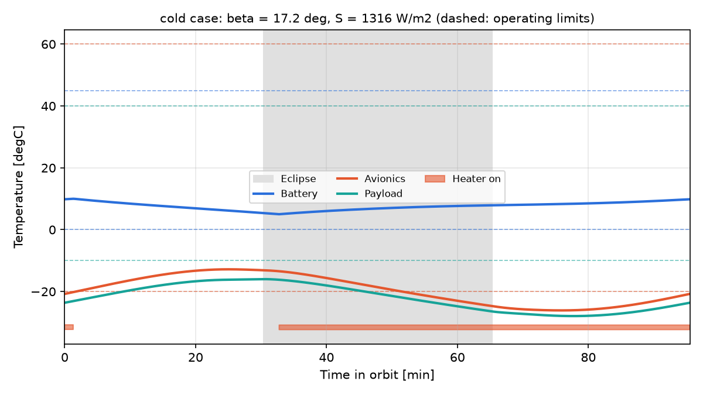
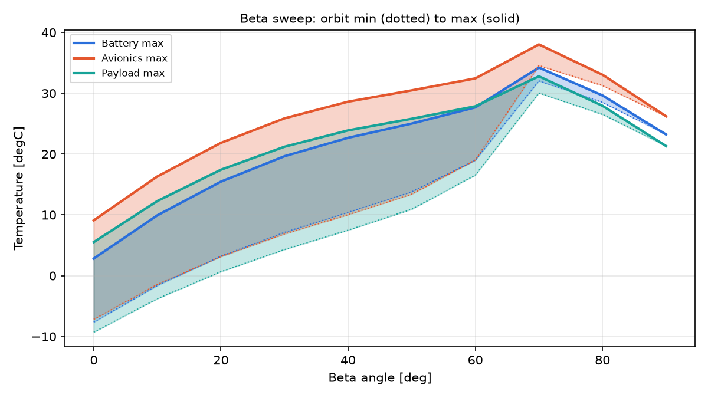

# CubeSat Thermal Agent

**An orbital thermal analysis engine for CubeSats, built to be driven by an AI agent through the Model Context Protocol (MCP).**

The goal is an agent that works like a thermal engineer during preliminary design (Phase 0/A). It runs hot and cold cases from a plain-language request, checks that the energy balance closes, verifies component margins, and sizes the fix when something fails. The physics comes from a validated nodal solver; the language model only chooses the tools and explains the results.

> Status: **v0.1, engine validated.** The MCP server (phase 2) is next.

## What it models

- **Spacecraft:** 3U CubeSat (0.10 × 0.10 × 0.34 m), nadir-pointing, body-mounted solar panels
- **Thermal network:** 10 nodes (6 external panels, frame, battery, avionics stack, camera payload), linear conductors from published contact conductances
- **Orbit:** circular sun-synchronous orbit at 550 km, LTDN 10:30. Over a year, β varies between 17.2° and 23.7°
- **Environment:** direct solar, albedo and Earth IR on every face, cylindrical eclipse, flat-plate view factors to Earth
- **Cases:** hot (EOL optics, cells not converting, high environment and dissipation) and cold (BOL, cells converting, low environment and dissipation), following the GSFC biasing practice
- **Control:** thermostatically controlled battery heater (5 °C to 10 °C band) solved with event detection. When the thermostat cycle does not repeat every orbit, the run converges over 10-orbit windows (quasi-periodic) and reports the window envelope
- **Acceptance:** predicted temperature ± 5 °C must stay inside operating limits, and heaters are sized to run at 68 % duty or less (70 % maximum minus 2 points of margin)

Everything is defined in [`model.yaml`](model.yaml), so a different spacecraft needs no code changes.

## Validation

All checks run in `pytest` (`tests/test_validation.py`):

| Id | Check | Reference | Result |
|---|---|---|---|
| V1 | Radiator sizing, 40 W box at 35 °C | NASA GSFC thermal course (Peabody 2022) | 0.102 m² (course: ≈ 0.1 m²) |
| V2 | Heater sizing for the same radiator | NASA GSFC thermal course | 6.33 W (course quotes ≈ 6.7 W from rounded inputs) |
| V3 | Eclipse duration at 550 km, β = 0° and 60° | Analytic | 35.6 min and 20.5 min, ± 0.2 min |
| V4 | Sun-normal plate equilibrium | Analytic, (αS/εσ)^¼ | 125.6 °C, ± 0.5 °C |
| V5 | Orbit energy balance closure, with and without thermostat | Q_in − Q_out − ΔU = 0 | < 0.01 % (limit 0.5 %) |
| V6 | Time-step independence | Tighter tolerances, 2× output | ΔT < 0.1 K |

## Baseline results

| Node | Hot case [°C] | Cold case [°C] | Status |
|---|---|---|---|
| Battery | 4.8 to 17.2 | −28.3 to −20.1 | **FAIL** cold (limit 0 °C) |
| Avionics | 4.6 to 23.5 | −28.8 to −16.3 | **FAIL** cold (limit −20 °C) |
| Payload | 2.1 to 19.0 | −30.5 to −19.4 | **FAIL** cold (limit −10 °C) |

The baseline design runs cold, which is common for small, high-emissivity spacecraft in a mid-morning orbit. The engine quantifies one fix for the battery:

| Battery mount | Heater needed (cold case) | Installed | Thermostat duty | Energy per orbit | Convergence |
|---|---|---|---|---|---|
| Baseline, G = 0.25 W/K | 5.25 W | 7.6 W | 66.2 % (10-orbit mean) | 8.0 Wh | quasi-periodic |
| Isolated, G = 0.05 W/K | 1.21 W | 1.9 W | 67.2 % | 2.0 Wh (−75 %) | periodic |

With the isolated mount and the 1.9 W thermostat-controlled heater, the battery stays between 5 °C and 20.5 °C in both cases.



The β sweep confirms a known lesson: the hottest case is not at the highest β. For this attitude, the peak is near β = 70°, just after eclipses end. Above that, the zenith face receives less sunlight.



## Quick start (Windows, macOS, Linux)

```bash
# install uv once: https://docs.astral.sh/uv/
uv sync                                  # creates .venv with all dependencies
uv run pytest                            # runs the V1-V6 validation suite
uv run python examples/run_cases.py      # hot/cold cases, heater sizing, plots in results/
```

```python
from cubesat_thermal import ThermalModel, check_margins, size_heater

model = ThermalModel.from_yaml("model.yaml")
cold = model.run("cold")
print(check_margins(model, cold))
print(size_heater(model.copy_with(conductor=("Battery", "Frame", 0.05))))
```

## Project structure

```
model.yaml                  spacecraft, orbit, coatings, conductors, cases, limits, heaters
src/cubesat_thermal/
    orbit.py                period, eclipse, view factors, SSO beta from LTDN
    environment.py          solar, albedo and Earth IR per face along the orbit
    model.py                network assembly, periodic transient solver, thermostat events, energy balance
    analysis.py             margins, heater sizing, beta sweep, GSFC hand calculations
    plotting.py             temperature, energy balance and beta-sweep plots
tests/test_validation.py    V1-V6
examples/run_cases.py       end-to-end run that produces results/
```

## Roadmap

1. **MCP server** (MCPServer): `describe_model`, `orbit_info`, `run_case`, `energy_balance`, `check_margins`, `beta_sweep`, `size_heater`, `modify_design`, `plot`, `generate_report`
2. Agent demo in Claude Code and a technical report generator
3. Power profiles over the orbit (imaging, downlink), deployable panels, internal radiation
4. An agent that drives industrial tools (Thermal Desktop via OpenTD, Simcenter 3D via NXOpen) on detailed models

## Limits of the model

The model is meant for preliminary design and is not a flight verification tool. It uses isothermal nodes and no internal radiation (v0.1). Albedo uses a cos ζ approximation with no terminator correction. External exchange is exact only because a box with body-mounted panels is convex.

## References

- NASA, *Passive Thermal Control Engineering Guidebook*, rev. 3.1, 2022 (public): orbits, worst cases, margins, contact conductances, thermostats
- H. Peabody, *Thermal Design for Spaceflight*, NASA GSFC course, 2022: environment values, hot/cold biasing, 5 °C and 70 % margin practice, radiator and heater hand calculations

## Author

Dante Cáceres, aeronautical engineer with 4 years in satellite thermal engineering (LEO and GEO thermal models, correlation, worst-case design) and 3+ years in CFD.
